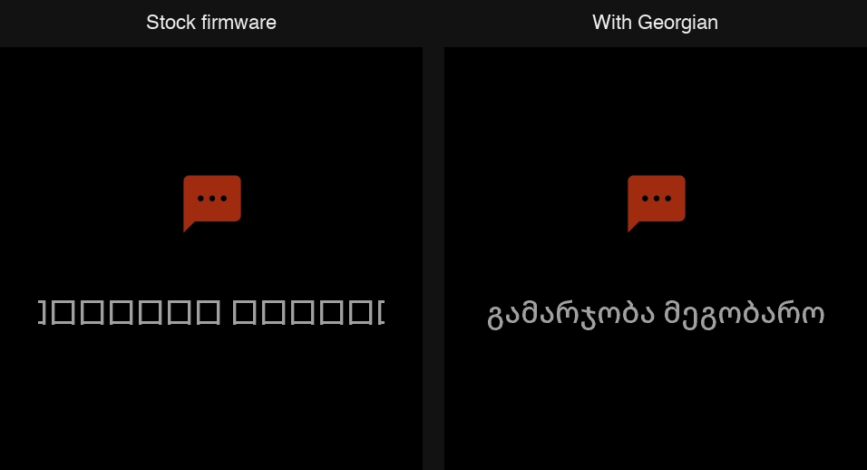
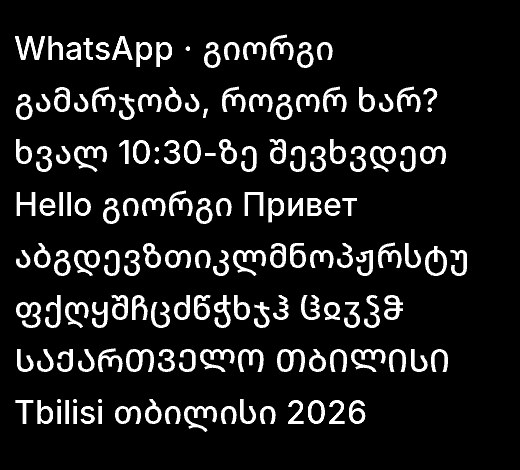

# Georgian for CMF Watch

ქართული შრიფტი CMF Watch Pro 2-ისთვის.

The CMF Watch Pro 2 shows Georgian text in notifications as boxes. This project adds Georgian
letters to the font the watch already uses for notifications, so messages show `ქართული` and
`ᲛᲗᲐᲕᲠᲣᲚᲘ` instead of `□□□□□□□`.



*The watch's own firmware running in the [cmf-watch-utils](https://github.com/fmctools/cmf-watch-utils)
emulator: stock on the left, with Georgian on the right.*

Unofficial; not affiliated with or endorsed by Nothing or CMF. Inspired by
[Georgian for Garmin](https://github.com/lubaretsi/georgian-for-garmin).

## Supported watches

| Watch | Firmware | Phone | Status |
|---|---|---|---|
| CMF Watch Pro 2 | 1.0.0.73 | iPhone | Tested: Georgian notifications show on the real watch |
| CMF Watch Pro 2 | 1.0.0.73 | Android | Should work (the font is on the watch, not the phone), not tested yet |
| CMF Watch Pro 2 | other versions | – | Not supported: the flash script stops |
| CMF Watch 3 Pro | – | – | Not supported (different firmware) |

## How it works

Unlike Garmin, the CMF watch has no folder for extra fonts: its fonts live inside the firmware.
So this project changes one file in the firmware and installs the whole package again over
Bluetooth, the same way an official update is installed.

1. `tools/build.sh` downloads the stock 1.0.0.73 firmware and checks its SHA-256.
2. It takes out `sans32.font`, the 32 px font the watch uses for notification text. It is in
   LVGL's binary font format and has no Georgian letters at all.
3. `tools/patch_font.py` draws all 96 modern Georgian letters (Mkhedruli U+10D0–10FF and
   Mtavruli U+1C90–1CBF) from [Noto Sans Georgian](https://github.com/notofonts/georgian) at the
   size and weight of the watch's Latin letters, and adds them to the font.
4. To keep the font file exactly the same size, it blanks 98 characters nobody needs on a watch:
   Kanbun marks (U+3190–31BA), CJK stroke symbols (U+31C0–31E3) and a few rare Arabic ligatures
   (U+FD50–FD62). Nothing else in the firmware changes.
5. [cmf-watch-utils](https://github.com/fmctools/cmf-watch-utils) puts the new font back, rebuilds
   the package and recomputes every checksum.



The build is reproducible. The result should have this SHA-256:

```
efe877ff048ae6837964ec9eeafcbfe7dd26fafc6bbe8f3cb84a8742cbbf1b6e  JX402_V1.0.0.73_georgian.bin
```

## Install

> [!WARNING]
> Installing firmware can fail. If it fails badly, the watch may not start, and there is no
> recovery method guaranteed to work. Read the
> [risks and limitations](https://cmf.arnv.dev/devices/cmf-watch-pro-2/limitations/) first.

You need a computer with Bluetooth (tested on a Mac), [git](https://git-scm.com/) and
[uv](https://docs.astral.sh/uv/getting-started/installation/). The charging cable is only for
power; it does not carry data.

1. Check the firmware version on the watch: **Settings → System → About**. It must be
   **1.0.0.73**.
2. Build:

   ```bash
   git clone https://github.com/NikkaNamoradze/georgian-for-cmf.git
   cd georgian-for-cmf
   tools/build.sh
   ```

3. Turn **Bluetooth off on your phone**. Put the watch on its charger next to the computer.
4. Install:

   ```bash
   tools/flash.sh
   ```

   The script connects to the watch, checks the model and the firmware version, and asks before
   sending anything. The transfer takes about 10 minutes. Then the watch restarts.
5. Turn phone Bluetooth back on. Nothing X reconnects to the watch as before.
6. Send yourself a message in Georgian.

## Undo

```bash
tools/flash.sh --restore
```

This sends the untouched stock 1.0.0.73 firmware back the same way.

## Good to know

- **Official updates remove it.** A firmware update from Nothing X replaces the font, and the
  boxes come back. Georgian has to be added again to the new version, which this project does
  not support yet.
- **Only notification text.** The patch covers the 32 px text font used for notifications.
  Menus stay in the watch's language, and Georgian is not one of the watch's languages.
- **Nothing here talks to Nothing's servers.** The watch is updated directly from your
  computer over Bluetooth.

## Credits and licenses

- Tools in this repository: [MIT](LICENSE). The bitmap compression in `tools/lvfont.py` follows
  [LVGL](https://github.com/lvgl/lvgl) and [lv_font_conv](https://github.com/lvgl/lv_font_conv)
  (MIT).
- [Noto Sans Georgian](fonts/NotoSansGeorgian.ttf): SIL Open Font License 1.1, see
  [fonts/OFL.txt](fonts/OFL.txt).
- [cmf-watch-utils](https://github.com/fmctools/cmf-watch-utils) by Arnav Kumar (AGPL-3.0) does the
  firmware unpacking, rebuilding and Bluetooth transfer. It is downloaded by `tools/build.sh` and
  is not part of this repository.
- The firmware belongs to Nothing / CMF. It is not stored in this repository; `tools/build.sh`
  downloads it from the cmf-watch-utils project.
